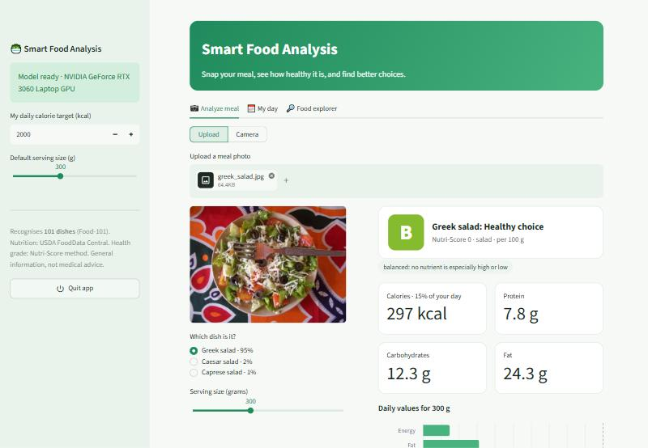
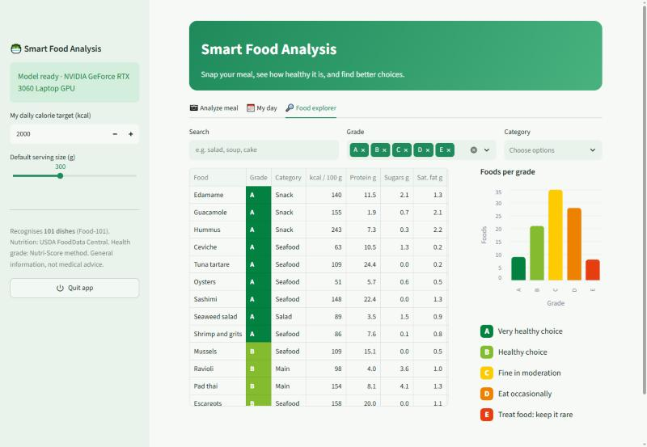

# Smart Food Analysis

Take a photo of a meal and find out **how healthy it is**. The app recognises the dish with a
Vision Transformer running on your GPU, gives it an **A–E health grade** (Nutri-Score method),
shows the nutrients for your portion against daily values, suggests **healthier swaps**, and keeps
a simple **meal diary** for the day. Everything runs locally and offline after setup.



> **Important: the model recognises only 101 dishes.** It was trained on the Food-101 dataset
> (full list below). A photo of anything else, for example fruit, vegetables or a home-cooked dish
> that is not on the list, will still be matched to the closest of the 101 dishes, so the result
> can be wrong. When the model's confidence is below 50%, the app shows a warning and the top 3
> guesses so you can pick the right dish.

## Features

- **Dish recognition**: top 3 guesses with confidence; choose the correct one if needed.
- **Health grade A–E**: Nutri-Score 2017 algorithm with plain-language reasons
  ("high in saturated fat", "good fibre").
- **Real nutrition data** for all 101 dishes from USDA FoodData Central: calories, protein, carbs,
  fat, saturated fat, sugars, fibre and sodium per 100 g and per portion.
- **Daily values chart**: how much of your day one portion uses, with limit nutrients in red.
- **Healthier swaps** from similar meal types with a better grade.
- **My day**: meals added today, calories against your target, nutrient totals, average grade.
- **Food explorer**: search and filter all 101 dishes by grade and category.
- **One-click start**: `SmartFood.exe` starts the dashboard and opens it in the browser.
- **GPU** (NVIDIA CUDA) with automatic CPU fallback.



## Accuracy

| Measure | Result |
|---|---|
| Model card accuracy (Food-101 evaluation set) | 89.1% |
| My test: 200 random Food-101 validation photos, top-1 | 92.0% |
| Same test, correct dish within top 3 guesses | 98.0% (top-5) |
| Speed on RTX 3060 Laptop GPU | about 22 ms per photo |

These numbers apply to photos of the 101 known dishes. They do not apply to other foods
(see the note above).

## How the health grade works

1. **Nutrition** (`scripts/build_nutrition.py` → `data/foods.csv`): every dish is mapped to the
   USDA FNDDS 2024 food database. 15 dishes without a single matching entry use a weighted mix,
   e.g. *fish and chips = 50% fried cod + 50% restaurant fries*.
2. **Nutri-Score** (`nutrition.py`): negative points for energy, sugars, saturated fat and sodium;
   positive points for fruit/vegetables/legumes, fibre and protein. Score ≤ -1 is **A**, 0–2 **B**,
   3–10 **C**, 11–18 **D**, 19+ **E**.
3. Grades across the 101 dishes: A 9, B 21, C 35, D 28, E 8.

## Setup (Windows)

1. Install Python 3.11+ (64-bit).
2. Double-click `INSTALL_WINDOWS.bat` (needs internet once). It installs the GPU build of PyTorch
   when an NVIDIA card is found (otherwise CPU) and downloads the food model into `models/food`.
3. Double-click **`SmartFood.exe`**. A small window shows "Starting…" and the dashboard opens in
   your browser. It runs only on your PC (`localhost`); photos never leave the computer.
4. Click **Quit app** in the sidebar to stop it.

Windows SmartScreen may warn once because the exe is not code-signed: **More info → Run anyway**.

Run without the exe:

```bat
.venv\Scripts\python.exe -m streamlit run app.py
```

Tests and data rebuild:

```bat
.venv\Scripts\python.exe -m unittest discover -s tests -t .
.venv\Scripts\python.exe scripts\build_nutrition.py   & rem needs the USDA CSV in data\raw
```

## The 101 recognised dishes

<details>
<summary>Show the list</summary>

Apple pie, Baby back ribs, Baklava, Beef carpaccio, Beef tartare, Beet salad, Beignets, Bibimbap,
Bread pudding, Breakfast burrito, Bruschetta, Caesar salad, Cannoli, Caprese salad, Carrot cake,
Ceviche, Cheese plate, Cheesecake, Chicken curry, Chicken quesadilla, Chicken wings, Chocolate cake,
Chocolate mousse, Churros, Clam chowder, Club sandwich, Crab cakes, Creme brulee, Croque madame,
Cup cakes, Deviled eggs, Donuts, Dumplings, Edamame, Eggs benedict, Escargots, Falafel,
Filet mignon, Fish and chips, Foie gras, French fries, French onion soup, French toast,
Fried calamari, Fried rice, Frozen yogurt, Garlic bread, Gnocchi, Greek salad,
Grilled cheese sandwich, Grilled salmon, Guacamole, Gyoza, Hamburger, Hot and sour soup, Hot dog,
Huevos rancheros, Hummus, Ice cream, Lasagna, Lobster bisque, Lobster roll sandwich,
Macaroni and cheese, Macarons, Miso soup, Mussels, Nachos, Omelette, Onion rings, Oysters, Pad thai,
Paella, Pancakes, Panna cotta, Peking duck, Pho, Pizza, Pork chop, Poutine, Prime rib,
Pulled pork sandwich, Ramen, Ravioli, Red velvet cake, Risotto, Samosa, Sashimi, Scallops,
Seaweed salad, Shrimp and grits, Spaghetti bolognese, Spaghetti carbonara, Spring rolls, Steak,
Strawberry shortcake, Sushi, Tacos, Takoyaki, Tiramisu, Tuna tartare, Waffles

</details>

## Project structure

```text
smart-food-analysis/
├── app.py                  # Streamlit dashboard
├── food_analyzer.py        # Dish recognition (GPU, offline) + top-3 guesses
├── nutrition.py            # Nutri-Score grade, daily values, healthier swaps
├── data/foods.csv          # USDA nutrition per 100 g for the 101 dishes
├── scripts/
│   ├── build_nutrition.py  # Builds data/foods.csv from USDA FNDDS
│   └── download_model.py   # Downloads the model into models/food
├── tests/test_nutrition.py
├── launcher/               # SmartFood.exe source, icon and build script
├── SmartFood.exe
└── INSTALL_WINDOWS.bat
```

## Limitations

- **Only 101 dishes** can be recognised (see above); other foods are matched to the closest dish.
- One dish per photo; mixed plates are classified as their most visible dish.
- Portion size comes from the slider, not from the photo.
- Dish nutrition is a typical USDA recipe; restaurant versions vary. The fruit/vegetable share used
  by the Nutri-Score is an estimate per dish.
- The Nutri-Score 2017 method has known quirks (e.g. fries can score B). It is a general guide,
  **not medical or dietary advice**.

## Credits and licenses

- Code: MIT (see `LICENSE`).
- Model: [`nateraw/food`](https://huggingface.co/nateraw/food) (Apache-2.0), ViT fine-tuned on
  [Food-101](https://data.vision.ee.ethz.ch/cvl/datasets_extra/food-101/).
- Nutrition data: [USDA FoodData Central](https://fdc.nal.usda.gov/), FNDDS 2024 (public domain).
- Health grade: Nutri-Score algorithm (Santé publique France).
